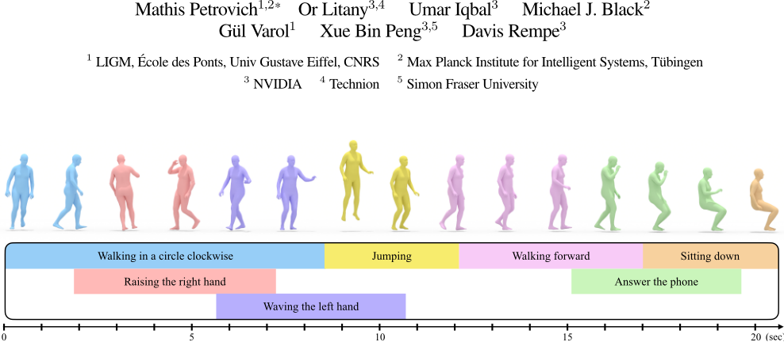
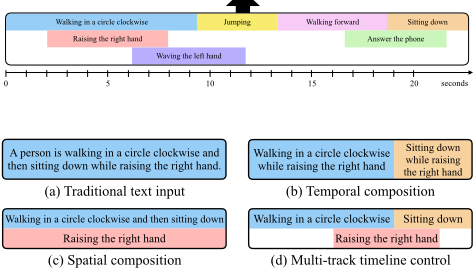
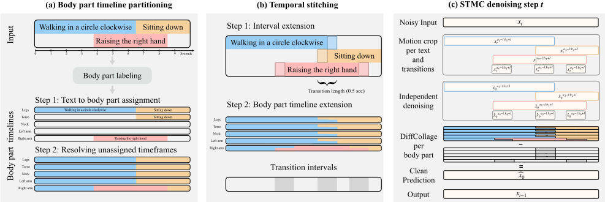
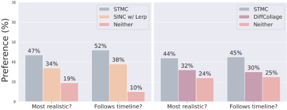
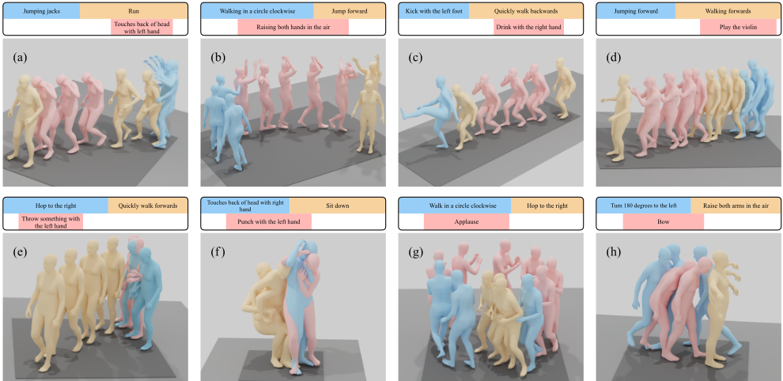
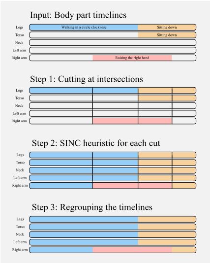
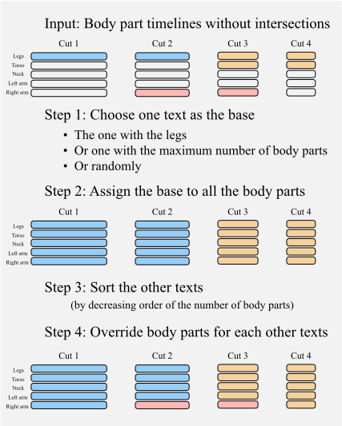
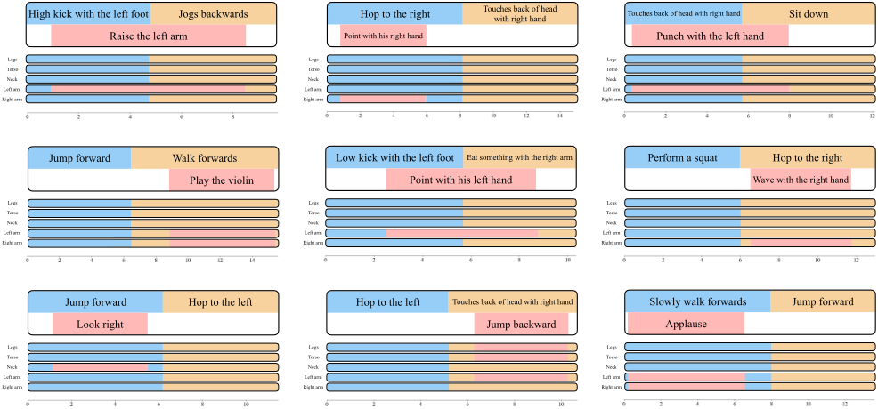

## Multi-Track Timeline Control for Text-Driven 3D Human Motion Generation

Figure 1. Multi-track timeline control: We introduce a new problem setting for text-driven motion synthesis, where the input consists of parallel tracks allowing simultaneous actions, as well as continuous temporal intervals enabling sequential actions. A long and complex motion can be generated (top) given the structured input of multiple simple textual descriptions, each corresponding to a temporal interval (bottom).



## Abstract

Recent advances in generative modeling have led to promising progress on synthesizing 3D human motion from text, with methods that can generate character animations from short prompts and specified durations. However, using a single text prompt as input lacks the fine-grained control needed by animators, such as composing multiple actions and defining precise durations for parts of the motion. To address this, we introduce the new problem of timeline control for text-driven motion synthesis, which provides an intuitive, yet fine-grained, input interface for users. Instead of a single prompt, users can specify a multi-track timeline of multiple prompts organized in temporal intervals that may overlap. This enables specifying the exact timings of each action and composing multiple actions in sequence or at overlapping intervals. To generate composite animations from a multi-track timeline, we propose a new test-time denoising method. This method can be integrated with any pre-trained motion diffusion model to synthesize realistic motions that accurately reflect the timeline. At every step of denoising, our method processes each timeline interval (text prompt) individually, subsequently aggregating the predictions with consideration for the specific body parts engaged in each action. Experimental comparisons and ablations validate that our method produces realistic motions that respect the semantics and timing of given text prompts.

*Work done during an internship at NVIDIA

## 1. Introduction

Motivated by applications in video games, entertainment, and virtual avatar creation, recent work has demonstrated substantial progress in learning to generate 3D human motion [29, 39, 46, 62]. Generating motions from text descriptions is of particular interest; it has the potential to democratize animation with a natural language interface that is intuitive for beginner and expert users alike. To this end, several methods have been proposed that synthesize reasonable character animations given a single text prompt and fixed duration as input [40, 55, 67].

While these methods are a promising first step towards faster and more accessible animation interfaces, they lack the precise control that is crucial for many animators. Consider the input prompt (see Fig. 2d): "A human walks in a circle clockwise, then sits, simultaneously raising their right hand towards the end of the walk, the hand raising halts midway through the sitting action." Due to a lack of representative training data, prior work struggles with such complex text prompts [40, 55]. Namely, the prompt includes temporal composition [4] where multiple actions are performed in sequence (e.g., walking then sitting), along with spatial composition [5] where several actions are performed simultaneously with differing body parts (e.g., walking while raising hand). Furthermore, such lengthy prompts quickly become unwieldy for the user and, despite their detailed descriptions, are still ambiguous with respect to the timing and duration of the constituent actions.

Figure 2. Text-driven motion synthesis tasks: Our framework generalizes (a) traditional text-to-motion synthesis given one text and one duration, (b) temporal composition given a sequence of texts for non-overlapping intervals, and (c) spatial composition given a set of texts for a single interval. (d) Multi-track timeline control uses a set of texts for arbitrary intervals, allowing fine-grained control over the timings of several complex actions.



To improve controllability, we propose the new problem of multi-track timeline control for text-driven 3D human motion synthesis. In this task, the user provides a structured and intuitive timeline as input (Fig. 1), which contains several (potentially overlapping) temporal intervals. Each interval corresponds to a precise textual description of a motion. As shown in Fig. 2d, the complex example prompt discussed earlier becomes simple to specify within the timeline, and allows animators to control the timing of each action. Such a timeline interface is already common in animation and video editing software, and is analogous to control interfaces that have recently emerged from the text-to-image community [66], e.g., image generation from a segmentation mask.

Multi-track timeline control for text-driven motion synthesis is a generalization of several motion synthesis tasks, and therefore brings many challenges. In particular, the multi-track timeline input can achieve (see Fig. 2):

- Text-to-motion synthesis [20, 40] - specifying a single interval (i.e., duration) with one textual description,
- Temporal composition [4, 68] - a sequence of textual descriptions corresponding to non-overlapping intervals,
- Spatial (body-part) composition [5] - a set of text prompts performed simultaneously with differing body parts.

Solving this task is difficult due to the lack of training data containing complex compositions and long durations. For example, a timeline-controlled model must handle the multi-track input containing several prompts, rather than a single text description. Moreover, the model must account for both spatial and temporal compositions to ensure seamless transitions, unlike prior work that has addressed each of these individually. The timeline also relaxes the assumption of a limited duration (&lt;10 sec) made by many recent text-to-motion approaches [12, 55, 67].

To address these challenges, we introduce a method for Spatio-Temporal Motion Collage (STMC). Our method copes with the lack of appropriate training data by operating at test time, leveraging a pre-trained motion diffusion model such as off-the-shelf MDM [55] or MotionDiffuse [67]. At each denoising step, STMC first applies the diffusion model on each text prompt in the timeline independently to predict a denoised motion for the corresponding intervals. Our key insight is to stitch together such independent generations in both space and time before continuing to denoise. For spatial compositions, automatic body part associations [5] allow coherently concatenating predictions together. Score arithmetic [68] is used to ensure smooth transitions for temporal compositions. To further improve the performance of STMC, we introduce MDM-SMPL, which makes several improvements to prior motion diffusion models [55], including directly using the SMPL [36] body representation.

The performance of STMC on timeline control for text-driven motion synthesis is verified through comprehensive comparisons and a perceptual user study. In summary, the central contribution of this work consists of: (i) the new problem of multi-track timeline control for text-driven 3D human motion synthesis, and (ii) a novel test-time technique, STMC, that effectively structures the denoising process to ensure faithful execution of all prompts in a timeline. As a side contribution, (iii) we upgrade MDM to directly support the SMPL body representation instead of skeletons, and reduce runtime through fewer denoising steps. Code is released on the project page.

## 2. Related Work

Human motion synthesis. A large body of work in both vision and graphics has been dedicated to generating 3D human motions [73]. This generation process can be unconditional [38, 58] or conditioned on actions [10, 19, 39], music [34, 52, 54, 59], speech [3, 72], goals [32, 53, 62], previous motion [14, 17, 46, 64] (i.e., future motion prediction), scenes/objects [23, 33, 60, 61], and text [1, 2, 12, 18, 21, 31, 55, 67]. Technical approaches vary from early statistical models [8, 17] to modern generative models like VAEs [22, 39, 40], GANs [6, 13, 51, 63], normalizing flows [24, 59], and diffusion [12, 31, 32, 62, 70]. Our work is most related to recent text-conditioned diffusion models [55, 67], however we solve a new problem where the model is conditioned on a timeline containing several text inputs instead of a single prompt.

Motion composition. Due to the lack of training data, a particular challenge for action and text-conditioned motion generation is to synthesize compositional motions. Several works [4, 43, 68] focus on generating motions from a sequence of text prompts and durations, i.e., temporal compositions. TEACH [4] autoregressively generates one motion (per text prompt) at a time, conditioning the next motion in the sequence with the previous one. EMS [43] proposes a two-stage approach, by first generating each action separately and then merging them through a subsequent network. Diffusion models EDGE [56] and PriorMDM [50] ensure consistency between adjacent motions by enforcing temporal constraints at transitions. Our approach to temporal composition is based on DiffCollage [68], which stitches motions (or images) together throughout the denoising process via score arithmetic at overlapping transitions.

Other work generates motions from a set of texts to be executed at the same time, i.e., spatial (body-part) composition. SINC [5] labels ground truth motion capture (mocap) sequences with corresponding body parts by prompting GPT-3 [9]. These labels are used to create a synthetic dataset of motions stitched together from mocap sequences with compatible body parts, thereby improving performance of VAE-based 3D motion generation methods [40] for spatial composition. MotionDiffuse [67] proposes a noise interpolation method to control different body part motions separately. Our approach, STMC, takes inspiration from SINC [5] by using body part labels to stitch motions together during test-time denoising. Overall, our problem of timeline-conditioned generation generalizes temporal and spatial composition, and STMC must tackle both issues simultaneously, unlike most prior work.

Controllable motion diffusion. Following success in image [45, 48, 49], video [28], and 3D [35, 42, 65] domains, diffusion has become a useful approach to generate highquality 3D human motions [3, 30, 56], especially from text inputs [12, 15, 55, 67]. Some works focus on improving the controllability of motion diffusion models, e.g., by enabling temporal [50, 68] and spatial [67] composition of text prompts. Other controls such as following specific keyframe poses, joint trajectories, and waypoints have also been achieved using a mix of test-time diffusion guidance [30, 32, 47], in-painting [50, 55], and direct conditioning [62]. We focus on making text-tomotion generation more controllable by handling several text prompts in a fine-grained timeline format through a compositional denoising process.

## 3. Human Motion Synthesis from Timelines

We first formulate the new problem setup of multi-track timeline control (Sec. 3.1), then propose a motion denoising strategy to handle timeline inputs (Sec. 3.2 and Sec. 3.3), and finally summarize our improved diffusion model (Sec. 3.4).

## 3.1. Timeline Control Problem Formulation

Inputs. As illustrated in Fig. 1, the multi-track timeline enables users to define multiple intervals, each linked to a natural language prompt describing the desired human motion. For the jth prompt in the timeline, we represent its temporal interval as [aj,bj] and the corresponding prompt as Cj. The intervals are arranged in a multi-track layout on the timeline, allowing for overlaps. Both the duration of each interval and of the overall timeline are variable, and users can add an arbitrary number of tracks (rows) to the timeline (although, in practice, a character can most often perform a handful of actions simultaneously).

Outputs. The goal is to generate a 3D human motion that follows all the text instructions at the specified intervals. A human motion x lasting N timesteps is represented as a sequence of pose vectors x=(x1,...,xN ) with each pose xi ∈Rd. Several recent works [55, 67] use the pose representation from Guo et al. [20] with d=263, which contains root velocities along with local joint positions, rotations, and velocities. Other pose representations like SMPL [36] can also be used (see Sec. 3.4).

## 3.2. Background: Motion Diffusion Models

Our generation method (Sec. 3.3) leverages a pre-trained motion diffusion model such as MDM [55] or MotionDiffuse [67] trained on single text prompts, which we briefly review here. These methods follow a denoising diffusion scheme and synthesize animations through iterative denoising of a noisy pose sequence. Given a clean motion x0, a Gaussian diffusion process is employed to corrupt the data to be approximately N(0,I). Each step of this process is given by:

<!-- formula-not-decoded -->

with βt defined by the noise schedule. Note the denoising step t is not to be confused with the temporal timestep i, which indexes the sequence of poses in the motion. In practice, one can make sampling xt easier by using the reparameterization trick xt = √¯αtx0+√1-¯αtϵ, where ϵ∼N(0,I), αt =1-βt, and ¯αt=∏ts=0αs.

Sampling from a diffusion model requires reversing this process to recover a clean motion from random noise. While q(xt-1|xt) is hard to compute, the probability conditioned on x0 is tractable [27]:

<!-- formula-not-decoded -->

where

<!-- formula-not-decoded -->

<!-- formula-not-decoded -->

Since xt is known at sampling time, we approximate the reverse distribution by training a denoising model ˆxθ(xt,t,C) to estimate x0, where C is the text conditioning. This model is trained with the simplified loss function as in Ho et al. [27] (i.e., without the t-dependent factor):

<!-- formula-not-decoded -->

with x0 and C sampled from a dataset of motion-text pairs, step t sampled uniformly, and noise ϵ∼N(0,I) used to corrupt the ground truth motion. To enable classifier-free guidance [26] at sampling time, the text conditioning C is dropped with some probability at each training iteration. At test time, the sampling (reverse) process starts from random noise and denoises iteratively for T steps to obtain a clean 3D human motion. At each denoising step, the model is conditioned on the single input text prompt (e.g., Fig. 2a).

## 3.3. STMC: Spatio-Temporal Motion Collage

STMC operates only at test time, enabling an off-the-shelf, pretrained denoising model to generate motion conditioned on a

̂

̂

̂

Figure 3. Overview of STMC: Before denoising, the multi-track timeline is first (a) partitioned into relevant body parts per text (using LLM-based labeling [5]) to create body part timelines, which are then (b) extended to overlap, leading to the transition intervals used for temporal stitching per body part with DiffCollage [68]. (c) At each denoising step, motions for each prompt are denoised independently before being combined based on the body-part timelines. The composite motion is re-noised by sampling xt-1 fromN(µt(xt,ˆx0),Σt) (as in Eq. (2)) before being passed to the next step.



multi-track timeline. At every denoising step, our method takes as input the current noisy motion xt encapsulating the entire timeline and outputs a corresponding clean motion ˆx0. As shown in Fig. 3c, STMC uses the denoising model to independently predict a clean motion crop corresponding to each of the input text prompts. These predictions are stitched together spatially using body part annotations for each text prompt (Fig. 3a), and stitched in time to ensure the clean motion smoothly spans the entire timeline (Fig. 3b). This final composite motion becomes the output of the current step ˆx0, which is used to sample xt-1 with Eq. (2) and continue the denoising process. To enable body part stitching, STMC assumes the denoiser operates on explicit poses [55, 67], rather than in a latent space [12].

Motion cropping and denoising. The input xt at denoising step t extends over the duration of the entire timeline. As shown in Fig. 3c, we first temporally split the input into motion "crops" to separately denoise each text prompt. For each interval [aj,bj], the motion is cropped in time to xaj:bj t =xt[aj :bj]. The crop, along with the text prompt Cj, is given to the denoising model to predict a corresponding clean motion crop ˆxaj:bj 0 . Denoising each text prompt independently gives high-quality motion from pre-trained models since each prompt typically contains a single action and the interval duration is reasonably short (&lt;10 sec).

Two or more text prompts in the timeline may overlap in time, meaning the predicted clean crops will also overlap. As a concrete example, suppose the crops for "walking in a circle" and "raising right hand" are overlapping, as in Fig. 3. In this case, it is not clear which of the two generated motions should be assigned to the overlapping region. To construct a motion that matches both prompts, we need the leg motion from "walking in a circle" and the right arm motion from "raising right hand". We therefore stitch together outputs from overlapping prompts based on automatically labeled body parts, as detailed next.

Spatial (body-part) stitching. Spatial stitching follows SINC [5], which proposed to combine compatible body-part motions from mocap sequences through simple concatenation. While SINC applies stitching only once, STMC does so at every step of denoising, encouraging a more coherent composition of movements by allowing the denoiser to correct any artifacts. This is possible because the denoiser outputs explicit human poses (i.e., we know which indices correspond to arms, legs, etc. within the pose vector), so we can extract body-part motions from separate crops and spatially combine them to obtain a composite motion. To achieve this, we first pre-process the input timeline to assign a text prompt to each body part at every timestep, thereby creating a separate motion timeline for every body part (see Fig. 3a): left arm, right arm, torso, legs and head.

As shown in Fig. 3a, each text prompt in the multi-track timeline is first annotated with a set of body parts involved in the motion. This can be done automatically by querying GPT-3 [9] as in SINC, or directly given by the user for additional creative control. Then, each text prompt is assigned to its annotated body parts within the corresponding time interval, which assumes that body parts at overlapping intervals are compatible (e.g., if a prompt is annotated with "legs", then no other prompt should involve legs throughout its entire interval). To fill in the remainder of the body-part timelines where body parts have not been annotated to a text prompt, heuristics similar to SINC are used. Please see the Appendix B and the Fig. A.1 for full details. Finally, during the denoising step (Fig. 3c), each crop xaj:bj t is split into separated body-part motions and concatenated together as specified by the body-part timelines to obtain the output ˆx0.

Temporal stitching. Because the motion crops are denoised independently, simple temporal concatenation of body-part motions from different text prompts will cause abrupt transitions. To mitigate these potential artifacts, we apply DiffCollage [68] to each body-part motion. As shown in Fig. 3b, instead of directly denoising xaj :bj t for each text prompt, we denoise an

̂

̂

̂

̂

expanded time interval [aj-l,bj+l], where l is the desired overlap length between adjacent motion crops (e.g., fixed to 0.25 sec). Concretely, for the temporal transition between prompts j and k, we have ˆxaj-l:bj+l 0 and ˆxak-l:bk+l 0 after denoising. We then unconditionally denoise a small (0.5 sec) crop of motion centered on the overlap between j and k to obtain ˆxuncond 0 . The final predicted motion spanning intervals j and k is computed as ˆx0 = ˆxaj-l:bj+l 0 +ˆxak-l:bk+l 0 - ˆxuncond 0 , as depicted in Fig. 3c. This equation derives from a factor graph representation of the problem, as detailed in DiffCollage [68].

## 3.4. SMPL Support for Motion Diffusion Model

While STMC works well with off-the-shelf models [55, 67] (see Sec. 4), we propose several practical improvements to MDM [55] to further enhance results. Our model, MDMSMPL, employs a skinned human body SMPL [36]: we use SMPL pose parameters instead of the joint rotation features in the original pose representation of Guo et al. [20]. In contrast to models that use the joint position outputs from the pose representation of [20], this SMPL-based representation avoids the need for expensive test-time optimization [7, 74] to fit the generated motion on a SMPL body. Moreover, the local joint rotations in SMPL, which are relative to parents in the kinematic tree, are more amenable to body-part stitching than root-relative joint positions. This is because any change to a joint rotation is propagated to all children in the kinematic tree, unlike root-relative joint positions which may not be coherent when simply concatenated together. Additional improvements include lowering the number of diffusion steps to T=100 from 1000 to substantially speed up sampling, and various architectural changes. We provide more details on MDM-SMPL in Appendix D, together with its performance on the standard HumanML3D text-to-motion synthesis benchmark.

## 4. Experiments

We first present the data (Sec. 4.1) and the evaluation protocols (Sec. 4.2) used in the experiments. We then show comparisons with baselines quantitatively (Sec. 4.3) and with a perceptual study (Sec. 4.4), followed by qualitative results (Sec. 4.5). We conclude with a discussion of the limitations (Sec. 4.6).

## 4.1. Datasets

HumanML3D [20] is a text-motion dataset that provides textual descriptions for a subset of the AMASS [37] and HumanAct12 [19] motion capture datasets. It consists of 44970 text annotations for 14616 motions. This dataset is used to train all diffusion models used in our experiments. For MDM [55] and MotionDiffuse [67], we use publicly available models pretrained on the released version of HumanML3D with the original motion representation from Guo et al. [20]. Consequently, these methods require test-time optimization to obtain SMPL pose parameter outputs. For training our MDM-SMPL diffusion model, which is designed to directly generate SMPL pose parameters, we re-process the dataset and exclude the HumanAct12 subset as SMPL poses are not available for this dataset. Multi-track timeline (MTT) dataset. To properly evaluate our new task, we introduce a new challenging dataset of 500 multitrack timelines. Each timeline in the dataset is automatically constructed and contains three prompts on a two-track timeline (e.g., Fig. 2d). To construct these timelines, we first manually collect a set of 60 texts covering a diverse set of "atomic" actions (e.g., "punch with the right hand", "jump forward", "run backwards", see Appendix C for the full list), and annotate the involved body parts for each text. To serve as ground truth for computing evaluation metrics (Sec. 4.2), we also select motion samples from AMASS that correspond to each text. Based on the atomic texts, we automatically generate timelines containing three prompts and two tracks (rows). For each timeline, the first track is filled with two consecutive prompts sampled from the set of texts and given randomized durations. A third random text with complementary body-part annotations is then placed in the second track at a random location in time.

The main reasons for restricting the evaluation to three prompts are (i) to keep the cognitive load for users low in the perceptual study, subsequently increasing the reliability of the results, and (ii) to construct a minimal setup where we can fairly compare against baselines in a controlled setting, eliminating confounding factors such as the number of prompts. Though these timelines contain only three prompts, they already pose a significant challenge (see Sec. 4.3). Examples of timelines in the dataset are provided in Fig. A.2 and qualitative results beyond three prompts can be found in the supplementary video.

## 4.2. Evaluation Metrics

Given the novelty of the task, identifying relevant metrics to evaluate different methods is crucial. Instead of relying on a single metric, we disentangle the evaluation of semantic correctness (how faithful individual motion crops are to the textual descriptions) from that of realism (e.g., temporal smoothness). Semantic metrics. Firstly, we evaluate the alignment between the generated motion and the text description within the specified intervals on the timeline, which we term "per-crop semantic correctness". To assess this, we utilize the recent text-to-motion retrieval model TMR [41]. Similar to how CLIP [44] functions for images and texts, TMR provides a joint embedding space that can be used to determine the similarity between a text and motion. Using TMR, we encode each atomic text prompt and corresponding motion from our MTT dataset to obtain ground truth text and motion embeddings, respectively. Each generated motion crop is also embedded and the TMR-Score, a measure of cosine similarity ranging from 0 to 1, is calculated between the generated motion embedding and the ground truth. We report both motion-to-text similarity by comparing against the ground truth text embedding (TMR-Score M2T) and motion-to-motion similarity against the ground truth motion embedding (TMRScore M2M). Such embedding similarity measures are akin to BERT-Score [69] for text-text, CLIP-Score [25] for image-text, and more recently TEMOS-Score [4] for motion-motion similarity. Since TMR is trained contrastively, its retrieval performance is better than TEMOS [40] which only trains with positive pairs, leading to our decision to instead use TMR-Score. Moreover, its embedding space is optimized with cosine similarity, making the values potentially more calibrated across samples.

Ideally, the TMR-Score M2T between a generated motion crop and the corresponding input text prompt should surpass those of other texts. Hence, we also measure motion-to-text retrieval metrics (as in [20]) including the frequency of the correct text prompt being in the top-1 (R@1) and top-3 (R@3) retrieved texts from the entire set of atomic texts.

Realismmetrics. Secondly, we evaluate the realism of the generated motions, which includes transitioning smoothly between actions. While the Frechet Inception Distance (FID) between generated and ground truth motion in a learned feature space (e.g., TMR) is a common metric for quality, the embedding space of TMR is not trained on motions that are longer than 10 sec, and may therefore be unreliable for longer motions. Hence, we follow DiffCollage [68] and compute the FID+ to evaluate transitions. The FID+ metric measures FID based on 5 random 5-second motion crops from each timeline-conditioned motion generation. Following TEACH [4], we also measure the transition distance as the Euclidean distance (in cm) between the poses in two consecutive frames around the transition time. We choose to compute this distance in the local coordinate system of the body to more effectively capture transitions for individual body parts, rather than being dominated by global motion. This metric is sensitive to abrupt pose changes, and a motion should not have high transition distance to remain realistic.

Perceptual study. Since no quantitative metric can fully capture the subtleties of human motion, we also conduct perceptual studies, where human raters on Amazon Mechanical Turk judge the quality of the generated motions [57]. To compare two generation methods, raters are presented with two videos of generated motions side-by-side rendered on a skeleton. The multi-track timeline is also visible with an animated bar that progresses along the timeline as the videos play. Users are asked which motion is more realistic and which one is better at following the text in the timeline; they may choose one of the two motions or mark "no preference". The studies presented in Sec. 4.3 are performed on a set of 100 motions with multiple raters judging each pair. The preference for each video is determined by a majority vote from all raters. Responses are filtered for quality by using three "warmup" questions at the start of each 15-question survey along with two "honeypot" examples with objectively correct answers. The honeypot examples test a rater's understanding of the task: one example shows a motion with obviously severe limb stretching (realism understanding test) and the other displays a motion generated from a different timeline than the one displayed (timeline understanding test). If a rater fails to answer either of these questions correctly, all of their responses are discarded.

## 4.3. Quantitative Comparison with Baselines

We apply our STMC test-time approach on the pretrained diffusion models of MotionDiffuse [67], MDM [55], and MDM-SMPL (ours). For each denoiser, we establish several strong baselines by repurposing existing methods to the timeline-conditioned generation task for comparison. Results are shown in Tab. 1. Next to each method, the table indicates how many tracks the input timelines have (#tracks) and how many text prompts can be contained in a track (#crops). Next, we introduce each baseline and analyze results.

Single-text input [55, 67] baseline. The simplest approach to condition motion diffusion on a timeline is to convert the timeline into a single text description, which aligns with the model's training input format (e.g., Fig. 2a). Given that our timeline dataset is consistently comprised of three motions (A, B, and C), we formulate single-text prompts as follows: "A and then B while C". While timing information can be included in the prompt, e.g., "A for 4 seconds", this is out-of-distribution for models trained on HumanML3D, leading to worse results. This method parallels the baseline strategies of SINC [5] for spatial composition and TEACH [4] for temporal composition.

As shown for each denoiser in Tab. 1, this approach is ineffective for both semantic correctness metrics and realism. Since these models cannot generate motions longer than 10 sec and there is no timing information in the prompt, for this experiment, outputs are limited to a maximum duration of 10 sec and semantic correctness metrics are reported over the entire duration of the motion rather than per-crop. The poor performance is a result of the models not being trained on the types of complex compositional prompts that result from collapsing the timeline to a single text description.

DiffCollage [68] baseline. Instead of converting the multi-track timeline into a single prompt, one can collapse it into a single track timeline containing a series of consecutive text prompts, i.e., transform the problem to be one of temporal composition. DiffCollage can then be used to temporally compose the sequence of actions. For example, the timeline in Fig. 2d would be split into ["walking in a circle," "walking in a circle while raising the right hand," "sitting down while raising the right hand," "sitting down"]. Note that, unlike the single-text baseline, this splitting preserves the timings (#crops) in the timeline.

While the DiffCollage baseline generally produces smooth transitions and reasonable FID scores, the semantic accuracy is consistently worse than STMC. This is due to the complex spatial compositions within the prompts after collapsing the timeline into a single track, which models trained on HumanML3D struggle with. In contrast, STMC uses body-part stitching throughout denoising to compose actions from simpler prompts. SINC [5] baseline. Rather than performing body-part stitching iteratively at every denoising step, an alternative approach is to stitch body motions together only once after all crops have finished the entire denoising process. This is most similar to SINC and forms the basis for two baselines that accept the full multi-track timeline as input, similar to STMC.

Table 1. Quantitative baseline comparison: Our method STMC is compared to several strong baselines when using three different denoising models. The single-text and DiffCollage baselines struggle to handle complex compositional prompts that results from collapsing the timeline down to a single track. The SINC baselines produce reasonable semantic accuracy by denoising prompts independently as in STMC, but cause abrupt or unnatural transitions with higher transition distance (underlined) or FID.

| Method             | Input type - #tracks   | Input type - #crops   |   Per-crop semantic correctness - R@1 ↑ |   Per-crop semantic correctness - R@3 ↑ |   Per-crop semantic correctness - TMR-Score ↑ - M2T |   Per-crop semantic correctness - TMR-Score ↑ - M2M |   Realism - FID ↓ |   Realism - Transition ↓ - distance |
|--------------------|------------------------|-----------------------|-----------------------------------------|-----------------------------------------|-----------------------------------------------------|-----------------------------------------------------|-------------------|-------------------------------------|
| Ground truth       | -                      | -                     |                                    55.0 |                                    73.3 |                                               0.748 |                                               1.000 |             0.000 |                                 1.5 |
| MotionDiffuse [67] | Single                 | Single                |                                    10.9 |                                    21.3 |                                               0.558 |                                               0.546 |             0.621 |                                 1.9 |
| DiffCollage        | Single                 | Multi                 |                                    22.6 |                                    43.3 |                                               0.633 |                                               0.612 |             0.532 |                                 4.6 |
| SINCw/o Lerp       | Multi                  | Multi                 |                                    23.8 |                                    45.9 |                                               0.656 |                                               0.630 |             0.554 |                                 3.8 |
| SINC w/ Lerp       | ′′                     | ′′                    |                                    24.9 |                                    46.7 |                                               0.663 |                                               0.632 |             0.552 |                                 1.0 |
| STMC (ours)        | ′′                     | ′′                    |                                    24.8 |                                    46.7 |                                               0.660 |                                               0.632 |             0.531 |                                 1.5 |
| MDM [55]           | Single                 | Single                |                                     9.5 |                                    19.7 |                                               0.556 |                                               0.549 |             0.666 |                                 2.5 |
| DiffCollage        | Single                 | Multi                 |                                    24.9 |                                    42.3 |                                               0.636 |                                               0.623 |             0.600 |                                 2.2 |
| SINCw/o Lerp       | Multi                  | Multi                 |                                    21.5 |                                    41.8 |                                               0.629 |                                               0.626 |             0.638 |                                10.2 |
| SINC w/ Lerp       | ′′                     | ′′                    |                                    23.3 |                                    43.1 |                                               0.634 |                                               0.628 |             0.630 |                                 2.8 |
| STMC (ours)        | ′′                     | ′′                    |                                    25.1 |                                    46.0 |                                               0.641 |                                               0.633 |             0.606 |                                 2.4 |
| MDM-SMPL           | Single                 | Single                |                                    12.1 |                                    23.5 |                                               0.573 |                                               0.578 |             0.484 |                                 1.8 |
| DiffCollage        | Single                 | Multi                 |                                    29.1 |                                    49.7 |                                               0.675 |                                               0.656 |             0.446 |                                 1.2 |
| SINCw/o Lerp       | Multi                  | Multi                 |                                    32.3 |                                    50.5 |                                               0.676 |                                               0.667 |             0.463 |                                 4.2 |
| SINC w/ Lerp       | ′′                     | ′′                    |                                    31.8 |                                    51.0 |                                               0.679 |                                               0.668 |             0.457 |                                 1.2 |
| STMC (ours)        | ′′                     | ′′                    |                                    30.5 |                                    50.9 |                                               0.675 |                                               0.665 |             0.459 |                                 0.9 |

Figure 4. Perception study results: Our STMC method is preferred over baselines by human raters for both motion realism and semantic accuracy. (Left) Comparison against the strong SINC with Lerp baseline. (Right) Comparison against the DiffCollage baseline. MDM [55] is used as the denoiser in these experiments.



SINC w/o Lerp concatenates body part motions at the end of denoising without considering temporal transitions. As a result, transitions tend to be abrupt as evidenced by high transition distances in Tab. 1 and occasional "teleporting" limbs in qualitative results. To mitigate this, SINC w/ Lerp employs linear interpolation (lerp) at transitions for smoother results, similar to the approach in TEACH [4]. Though this leads to smoothness at transitions, FID scores tend to be slightly higher than STMC. The cause is obvious qualitatively, where the generated motion often appears mechanical and unnatural, sometimes resulting in foot sliding. Despite issues with motion quality, these SINC baselines effectively capture the semantics of each motion crop since crops are denoised independently.

Analysis of the results. Our method STMC consistently performs effectively across both semantic and realism metrics, unlike baselines that tend to sacrifice performance in one category for the other. For example, DiffCollage achieves the best FID using MDM, but its inability to handle spatial compositions results in worse semantics than STMC across all models. Additionally, SINC baselines perform best in terms of semantics for MotionDiffuse and MDM-SMPL, but result in abrupt or unnatural transitions with FID or transition distance that is often higher than STMC. Such transitions are also readily apparent in qualitative results (see supplementary video). It is also notable that using MDM-SMPL with STMC performs on par with MDM and MotionDiffuse, while enabling direct SMPL output and significantly reducing (by 10×) the number of diffusion steps. Fewer steps, combined with pre-computing text embeddings, enable sampling MDM-SMPL in less than 5 seconds on average. This is a substantial improvement over MDM, which takes 4 minutes to generate motions followed by 8 min of optimization to obtain SMPL poses, on average.

While the performance of STMC is promising, the semantic metrics for ground truth motions indicate room for improvement. As discussed in Sec. 4.6, STMC is currently limited by the pre-trained diffusion model that it leverages for each motion crop; we expect improvements in these models to also boost STMC. An additional experiment on varying the overlap length for temporal stitching can be found in Appendix E, as well as an evaluation of individual sub-motions.

## 4.4. Perceptual Study

We perform two separate user studies to compare STMC to SINC with Lerp and DiffCollage when using MDM. Fig. 4 shows results of both studies, measuring human preference for motion realism and semantic accuracy. On the left, STMC is preferred or similar to SINC 66% of the time for realism and 62% of the time for semantic accuracy, with 4.2 raters judging each video on average after filtering bad responses. Compared to DiffCollage on the right, our method is preferred or similar 68% of the time for realism and 70% for semantic accuracy, with 2.8 raters judging each video after filtering. This demonstrates that STMC improves the motion in ways that are discernible by humans but may not be fully captured in quantitative metrics.

Figure 5. Qualitative results: We visualize the results of STMC with MDM-SMPL on several input timelines and color the bodies depending on their location in the timeline. We see that STMC is capable of generating realistic motions, which capture the semantics of the given text prompts with the desired timing and duration. In (a) and (c), STMC generates motions that precisely follow the instructions, controlling a single arm while still performing another action. The accurate timing of intervals is demonstrated in (b) where the arms are still up in the air when transitioning from "walking" to "jumping", which is difficult to achieve with alternative methods. In (c) and (d), we observe that STMC is capable of generating compositions that were not present in the ground truth data, such as "walking backwards while eating" or "walking while playing violin".



## 4.5. Qualitative Results

We visualize motions generated by STMC with MDM-SMPL in Figure 5, given multi-track timelines as input from our MTT dataset. The coloring follows the input text, prioritizing the newest prompt when there is an overlap across tracks. These results show that STMC is capable of generating realistic motions for complex multi-prompt timelines, which follow the timing and duration of the given intervals. Please see the caption for full analysis of these examples, and we refer to the supplementary video for additional qualitative results and comparison to generated motions from baseline methods.

## 4.6. Limitations

While STMC expands the capabilities of pre-trained motion diffusion models to take a multi-track timeline as input, it is also limited by the models that it relies on. For example, our proposed body-part stitching process produces spatially composed motions throughout denoising that the off-the-shelf models are not trained to robustly handle. One potential direction to ameliorate this is a more sophisticated stitching "schedule" where body parts are not combined until later in the denoising process instead of at every step. STMC also inherits the limitations of SINC, e.g., restricting overlapping motions to have compatible body part combinations. Finally, the generated motions might not follow exactly the right timings. One reason could be due to a bias in the training data, where the action often starts with a delay.

## 5. Conclusion

In this work, we proposed the new problem of multi-track timeline control for text-driven 3D human motion generation. The timeline input gives users fine-grained control over the timing and duration of actions, while still maintaining the simplicity of natural language. We tackled this challenging problem using a new test-time denoising process called spatio-temporal motion collage (STMC), which enables pre-trained diffusion models to handle the spatial and temporal compositions present in timelines. Finally, extensive quantitative and qualitative evaluation demonstrated the advantage of STMC over strong baseline methods and its ability to generate realistic motions that are faithful to a multi-track timeline from the user.

Acknowledgements. This work was granted access to the HPC resources of IDRIS under the allocation 2023-AD011012129R3 made by GENCI. GV acknowledges the ANR project CorVis ANR-21-CE23-0003-01. The authors would like to thank Nicolas Dufour for the interesting discussions on diffusion models.

[MJB Disclosure: https://files.is.tue.mpg.de/black/ CoI\_CVPR\_2024.txt](https://files.is.tue.mpg.de/black/CoI_CVPR_2024.txt)

## References

- [1] Hyemin Ahn, Timothy Ha, Yunho Choi, Hwiyeon Yoo, and Songhwai Oh. Text2Action: Generative adversarial synthesis from language to action. In International Conference on Robotics and Automation (ICRA), 2018. 2
- [2] Chaitanya Ahuja and Louis-PhilippeMorency. Language2Pose: Natural language grounded pose forecasting. In International Conference on 3D Vision (3DV), 2019. 2
- [3] Simon Alexanderson, Rajmund Nagy, Jonas Beskow, and Gustav Eje Henter. Listen, denoise, action! audio-driven motion synthesis with diffusionmodels. ACMTransactions on Graphics (TOG), 2023. 2, 3
- [4] Nikos Athanasiou, Mathis Petrovich, Michael J. Black, and G¨ul Varol. TEACH: Temporal action composition for 3D humans. In International Conference on 3D Vision (3DV), 2022. 1, 2, 6, 7
- [5] Nikos Athanasiou, Mathis Petrovich, Michael J. Black, and G¨ul Varol. SINC: Spatial composition of 3D human motions for simultaneous action generation. In International Conference on Computer Vision (ICCV), 2023. 1, 2, 3, 4, 6, 11
- [6] Emad Barsoum, John Kender, and Zicheng Liu. HP-GAN: Probabilistic 3D human motion prediction via GAN. In Computer Vision and Pattern Recognition Workshops (CVPRW), 2018. 2
- [7] Federica Bogo, Angjoo Kanazawa, Christoph Lassner, Peter Gehler, Javier Romero, and Michael J. Black. Keep it SMPL: Automatic estimation of 3D human pose and shape from a single image. In European Conference on Computer Vision (ECCV), 2016. 5, 13
- [8] Richard Bowden. Learning statistical models of human motion. In Computer Vision and Pattern Recognition (CVPR), Workshop on Human Modeling, Analysis and Synthesis, 2000. 2
- [9] Tom Brown, Benjamin Mann, Nick Ryder, Melanie Subbiah, Jared D Kaplan, Prafulla Dhariwal, Arvind Neelakantan, Pranav Shyam, Girish Sastry, Amanda Askell, Sandhini Agarwal, Ariel Herbert-Voss, Gretchen Krueger, Tom Henighan, Rewon Child, Aditya Ramesh, Daniel Ziegler, Jeffrey Wu, Clemens Winter, Chris Hesse, Mark Chen, Eric Sigler, Mateusz Litwin, Scott Gray, Benjamin Chess, Jack Clark, Christopher Berner, Sam McCandlish, Alec Radford, Ilya Sutskever, and Dario Amodei. Language models are few-shot learners. In Neural Information Processing Systems (NeurIPS), 2020. 3, 4
- [10] Pablo Cervantes, Yusuke Sekikawa, Ikuro Sato, and Koichi Shinoda. Implicit neural representations for variable length humanmotion generation. In EuropeanConference onComputer Vision (ECCV), 2022. 2
- [11] Ting Chen. On the importance of noise scheduling for diffusion models. arXiv:2301.10972, 2023. 13
- [12] Xin Chen, Biao Jiang, Wen Liu, Zilong Huang, Bin Fu, Tao Chen, Jingyi Yu, and Gang Yu. Executing your commands via motion diffusion in latent space. In Computer Vision and Pattern Recognition (CVPR), 2023. 2, 3, 4
- [13] B. Chopin, N. Otberdout, M. Daoudi, and A. Bartolo. Human motion prediction using manifold-aware wasserstein gan. In International Conference on Automatic Face and Gesture Recognition, 2021. 2
- [14] Enric Corona, Albert Pumarola, Guillem Aleny`a, and Francesc Moreno-Noguer. Context-aware human motion prediction. In Computer Vision and Pattern Recognition (CVPR), 2020. 2
- [15] Rishabh Dabral, Muhammad Hamza Mughal, Vladislav Golyanik, and Christian Theobalt. MoFusion: A framework for denoising-diffusion-basedmotion synthesis. In Computer Vision and Pattern Recognition (CVPR), 2023. 3
- [16] Timoth´ee Darcet, Maxime Oquab, Julien Mairal, and Piotr Bojanowski. Vision transformers need registers. In International Conference on Learning Representations (ICLR), 2024. 13
- [17] Aphrodite Galata, Neil Johnson, and David Hogg. Learning variable length markov models of behaviour. Computer Vision and Image Understanding (CVIU), 2001. 2
- [18] Anindita Ghosh, Noshaba Cheema, Cennet Oguz, Christian Theobalt, and Philipp Slusallek. Synthesis of compositional animations from textual descriptions. In International Conference on Computer Vision (ICCV), 2021. 2
- [19] Chuan Guo, Xinxin Zuo, Sen Wang, Shihao Zou, Qingyao Sun, Annan Deng, Minglun Gong, and Li Cheng. Action2Motion: Conditioned generation of 3D human motions. In ACM International Conference on Multimedia (ACMMM), 2020. 2, 5
- [20] Chuan Guo, Shihao Zou, Xinxin Zuo, Sen Wang, Wei Ji, Xingyu Li, and Li Cheng. Generating diverse and natural 3D human motions from text. In Computer Vision and Pattern Recognition (CVPR), 2022. 2, 3, 5, 6, 12, 13
- [21] Chuan Guo, Xinxin Zuo, Sen Wang, and Li Cheng. TM2T: Stochastic and tokenized modeling for the reciprocal generation of 3d human motions and texts. In European Conference on Computer Vision (ECCV), 2022. 2
- [22] Ikhsanul Habibie, Daniel Holden, Jonathan Schwarz, Joe Yearsley, and Taku Komura. A recurrent variational autoencoder for human motion synthesis. In British Machine Vision Conference (BMVC), 2017. 2
- [23] Mohamed Hassan, Duygu Ceylan, Ruben Villegas, Jun Saito, Jimei Yang, Yi Zhou, and Michael J Black. Stochastic scene-aware motion prediction. In Computer Vision and Pattern Recognition (CVPR), 2021. 2
- [24] Gustav Eje Henter, Simon Alexanderson, and Jonas Beskow. MoGlow: Probabilistic and controllable motion synthesis using normalising flows. ACM Transactions on Graphics (TOG), 2020. 2
- [25] Jack Hessel, Ari Holtzman, Maxwell Forbes, Ronan Le Bras, and Yejin Choi. CLIPScore: A reference-free evaluation metric for image captioning. In EMNLP, 2021. 5
- [26] Jonathan Ho and Tim Salimans. Classifier-free diffusion guidance. arXiv:2207.12598, 2022. 3
- [27] Jonathan Ho, Ajay Jain, and Pieter Abbeel. Denoising diffusion probabilistic models. In Neural Information Processing Systems (NeurIPS), 2020. 3
- [28] Jonathan Ho, Tim Salimans, Alexey Gritsenko, WilliamChan, Mohammad Norouzi, and David J Fleet. Video diffusion models. arXiv:2204.03458, 2022. 3
- [29] Daniel Holden, Jun Saito, and Taku Komura. A deep learning framework for character motion synthesis and editing. ACM Transactions on Graphics (TOG), 2016. 1, 12
- [30] Siyuan Huang, ZanWang, Puhao Li, Baoxiong Jia, Tengyu Liu, Yixin Zhu, Wei Liang, and Song-Chun Zhu. Diffusion-based generation, optimization, and planning in 3d scenes. In Proceedings of the IEEE/CVF Conference on Computer Vision and Pattern Recognition (CVPR), 2023. 3

- [31] Peng Jin, Yang Wu, Yanbo Fan, Zhongqian Sun, Yang Wei, and Li Yuan. Act as you wish: Fine-grained control of motion diffusion model with hierarchical semantic graphs. In Neural Information Processing Systems (NeurIPS), 2023. 2
- [32] Korrawe Karunratanakul, Konpat Preechakul, Supasorn Suwajanakorn, and Siyu Tang. Gmd: Controllable human motion synthesis via guided diffusionmodels. In International Conference on Computer Vision (ICCV), 2023. 2, 3
- [33] Nilesh Kulkarni, Davis Rempe, Kyle Genova, Abhijit Kundu, Justin Johnson, David Fouhey, and Leonidas Guibas. NIFTY: Neural object interaction fields for guided human motion synthesis. arXiv:2307.07511, 2023. 2
- [34] Ruilong Li, Shan Yang, David A. Ross, and Angjoo Kanazawa. AI choreographer: Music conditioned 3D dance generation with AIST++. In International Conference on Computer Vision (ICCV), 2021. 2
- [35] Chen-Hsuan Lin, Jun Gao, Luming Tang, Towaki Takikawa, Xiaohui Zeng, Xun Huang, Karsten Kreis, Sanja Fidler, Ming-Yu Liu, and Tsung-Yi Lin. Magic3d: High-resolution text-to-3D content creation. In Computer Vision and Pattern Recognition (CVPR), 2023. 3
- [36] MatthewLoper, NaureenMahmood, JavierRomero, GerardPonsMoll, and Michael J. Black. SMPL: A skinned multi-person linear model. ACMTransactions on Graphics (TOG), 2015. 2, 3, 5, 12
- [37] Naureen Mahmood, Nima Ghorbani, Nikolaus F. Troje, Gerard Pons-Moll, and Michael J. Black. AMASS: Archive of motion capture as surface shapes. In International Conference on Computer Vision (ICCV), 2019. 5
- [38] Dirk Ormoneit, Michael J. Black, Trevor Hastie, and Hedvig Kjellstr¨om. Representing cyclic human motion using functional analysis. Image and Vision Computing, 2005. 2
- [39] Mathis Petrovich, Michael J. Black, and G¨ul Varol. Actionconditioned 3D human motion synthesis with transformer VAE. In International Conference on Computer Vision (ICCV), 2021. 1, 2
- [40] Mathis Petrovich, Michael J. Black, and G¨ul Varol. TEMOS: Generating diverse human motions from textual descriptions. In European Conference on Computer Vision (ECCV), 2022. 1, 2, 3, 6
- [41] Mathis Petrovich, Michael J. Black, and G¨ul Varol. TMR: Textto-motion retrieval using contrastive 3D human motion synthesis. In International Conference on Computer Vision (ICCV), 2023. 5
- [42] Ben Poole, Ajay Jain, Jonathan T. Barron, and Ben Mildenhall. Dreamfusion: Text-to-3D using 2D diffusion. In International Conference on Learning Representations (ICLR), 2022. 3
- [43] Yijun Qian, Jack Urbanek, Alexander G. Hauptmann, and Jungdam Won. Breaking the limits of text-conditioned 3D motion synthesis with elaborative descriptions. In International Conference on Computer Vision (ICCV), 2023. 2
- [44] Alec Radford, Jong Wook Kim, Chris Hallacy, Aditya Ramesh, Gabriel Goh, Sandhini Agarwal, Girish Sastry, Amanda Askell, Pamela Mishkin, Jack Clark, Gretchen Krueger, and Ilya Sutskever. Learning transferable visual models from natural language supervision. In International Conference onMachine Learning (ICML), 2021. 5
- [45] Aditya Ramesh, Mikhail Pavlov, Gabriel Goh, Scott Gray, Chelsea Voss, Alec Radford, Mark Chen, and Ilya Sutskever. Zero-shot text-to-image generation. In International Conference on Machine Learning (ICML), 2021. 3
- [46] Davis Rempe, Tolga Birdal, Aaron Hertzmann, Jimei Yang, Srinath Sridhar, and Leonidas J. Guibas. HuMoR: 3D human motion model for robust pose estimation. In International Conference on Computer Vision (ICCV), 2021. 1, 2
- [47] Davis Rempe, Zhengyi Luo, Xue Bin Peng, Ye Yuan, Kris Kitani, Karsten Kreis, Sanja Fidler, and Or Litany. Trace and pace: Controllable pedestrian animation via guided trajectory diffusion. In Conference on Computer Vision and Pattern Recognition (CVPR), 2023. 3
- [48] Robin Rombach, Andreas Blattmann, Dominik Lorenz, Patrick Esser, and Bj¨orn Ommer. High-resolution image synthesis with latent diffusion models. In Computer Vision and Pattern Recognition (CVPR), 2022. 3
- [49] Chitwan Saharia, William Chan, Saurabh Saxena, Lala Li, Jay Whang, Emily Denton, Seyed Kamyar Seyed Ghasemipour, Burcu Karagol Ayan, S. Sara Mahdavi, Rapha Gontijo Lopes, Tim Salimans, Jonathan Ho, David J Fleet, and Mohammad Norouzi. Photorealistic text-to-image diffusion models with deep language understanding. In Neural Information Processing Systems (NeurIPS), 2022. 3
- [50] Yonatan Shafir, Guy Tevet, Roy Kapon, and Amit H Bermano. Humanmotion diffusion as a generative prior. arXiv:2303.01418, 2023. 2, 3
- [51] Ayumi Shiobara and Makoto Murakami. Human motion generation using wasserstein GAN. In International Conference on Digital Signal Processing (ICDSP), 2021. 2
- [52] Jiangxin Sun, ChunyuWang, Huang Hu, Hanjiang Lai, Zhi Jin, and Jian-Fang Hu. You never stop dancing: Non-freezing dance generation via bank-constrainedmanifold projection. In Neural Information Processing Systems (NeurIPS), 2022. 2
- [53] Omid Taheri, Vasileios Choutas, Michael J. Black, and Dimitrios Tzionas. GOAL: Generating 4D whole-body motion for handobject grasping. In Computer Vision and Pattern Recognition (CVPR), 2022. 2
- [54] Taoran Tang, Jia Jia, and Hanyang Mao. Dance with melody: An LSTM-autoencoder approach to music-oriented dance synthesis. In ACM International Conference on Multimedia (ACMMM), 2018. 2
- [55] Guy Tevet, Sigal Raab, Brian Gordon, Yoni Shafir, Daniel Cohen-or, and Amit Haim Bermano. Human motion diffusion model. In International Conference on Learning Representations (ICLR), 2023. 1, 2, 3, 4, 5, 6, 7, 13
- [56] Jonathan Tseng, Rodrigo Castellon, and C Karen Liu. EDGE: Editable dance generation frommusic. In Computer Vision and Pattern Recognition (CVPR), 2023. 2, 3
- [57] AmazonMechanical Turk, 2023. https://www.mturk.com/. 6
- [58] Raquel Urtasun, David J. Fleet, and Neil D. Lawrence. Modeling human locomotion with topologically constrained latent variable models. In HumanMotion - Understanding, Modeling, Capture and Animation, 2007. 2
- [59] Guillermo Valle-P´erez, Gustav Eje Henter, Jonas Beskow, Andr´e Holzapfel, Pierre-Yves Oudeyer, and Simon Alexanderson. Transflower: probabilistic autoregressive dance generation with multimodal attention. ACMTransactions onGraphics (TOG), 2021. 2
- [60] JiashunWang, Huazhe Xu, Jingwei Xu, Sifei Liu, and Xiaolong Wang. Synthesizing long-term 3D human motion and interaction in 3d scenes. In Computer Vision and Pattern Recognition (CVPR), 2021. 2

- [61] Zan Wang, Yixin Chen, Tengyu Liu, Yixin Zhu, Wei Liang, and Siyuan Huang. HUMANISE: Language-conditioned human motion generation in 3d scenes. In Neural Information Processing Systems (NeurIPS), 2022. 2
- [62] Yiming Xie, Varun Jampani, Lei Zhong, Deqing Sun, and Huaizu Jiang. Omnicontrol: Control any joint at any time for human motion generation. arXiv:2310.08580, 2023. 1, 2, 3
- [63] Liang Xu, Ziyang Song, Dongliang Wang, Jing Su, Zhicheng Fang, Chenjing Ding, Weihao Gan, Yichao Yan, Xin Jin, Xiaokang Yang, Wenjun Zeng, and Wei Wu. ActFormer: A gan-based transformer towards general action-conditioned 3d human motion generation. In International Conference on Computer Vision (ICCV), 2023. 2
- [64] Ye Yuan and Kris Kitani. DLow: Diversifying latent flows for diverse human motion prediction. In European Conference on Computer Vision (ECCV), 2020. 2
- [65] Xiaohui Zeng, Arash Vahdat, Francis Williams, Zan Gojcic, Or Litany, Sanja Fidler, and Karsten Kreis. Lion: Latent point diffusion models for 3d shape generation. Advances in Neural Information Processing Systems (NeurIPS), 2022. 3
- [66] Lvmin Zhang, Anyi Rao, and Maneesh Agrawala. Adding conditional control to text-to-image diffusion models. In International Conference on Computer Vision (ICCV), 2023. 2
- [67] Mingyuan Zhang, Zhongang Cai, Liang Pan, Fangzhou Hong, Xinying Guo, Lei Yang, and Ziwei Liu. MotionDiffuse: Text-driven human motion generation with diffusion model. arXiv:2208.15001, 2022. 1, 2, 3, 4, 5, 6, 7, 13
- [68] Qinsheng Zhang, Jiaming Song, Xun Huang, Yongxin Chen, and Ming yu Liu. Diffcollage: Parallel generation of large content with diffusionmodels. In Computer Vision and Pattern Recognition (CVPR), 2023. 2, 3, 4, 5, 6
- [69] Tianyi Zhang, Varsha Kishore, FelixWu, Kilian Q. Weinberger, and Yoav Artzi. BERTScore: Evaluating text generation with BERT. In ICLR, 2020. 5
- [70] Zihan Zhang, Richard Liu, Kfir Aberman, and Rana Hanocka. TEDi: Temporally-entangled diffusion for long-term motion synthesis. arXiv:2307.15042, 2023. 2
- [71] Yi Zhou, Connelly Barnes, Jingwan Lu, Jimei Yang, and Hao Li. On the continuity of rotation representations in neural networks. In Computer Vision and Pattern Recognition (CVPR), 2019. 12
- [72] Lingting Zhu, Xian Liu, Xuanyu Liu, Rui Qian, Ziwei Liu, and Lequan Yu. Taming diffusion models for audio-driven co-speech gesture generation. In Computer Vision and Pattern Recognition (CVPR), 2023. 2
- [73] Wentao Zhu, Xiaoxuan Ma, Dongwoo Ro, Hai Ci, Jinlu Zhang, Jiaxin Shi, Feng Gao, Qi Tian, and Yizhou Wang. Human motion generation: A survey. arXiv:2307.10894, 2023. 2
- [74] Xinxin Zuo, Sen Wang, Jiangbin Zheng, Weiwei Yu, Minglun Gong, Ruigang Yang, and Li Cheng. Sparsefusion: Dynamic human avatar modeling from sparse rgbd images. IEEE Transactions on Multimedia, 2021. 5, 13

## APPENDIX

We encourage the reader to view the supplementary video to observe qualitative results in motion (see Section A for interpretation). This appendix includes additional details about our STMC method (Section B), the creation of the MTT dataset

(Section C), and our MDM-SMPL model (Section D). We also present supplementary experiments in Section E.

## A. Supplementary Video with Qualitative Results

Besides this appendix, we provide a video on our webpage* where we visually explain the method and show qualitative results from STMC, along with a comparison to the baselines. By looking at the generated motions in the video, we can see more clearly the differences between the baselines and STMC. In particular, although SINC w/ Lerp has good metrics overall, some motions do not look natural to the human eye.

## B. Spatio-Temporal Motion Collage (STMC)

Resolving unassigned timeframes. This step corresponds to Step 2 of Fig. 3a of the main paper. As shown in Fig. A.1, we first cut the body part timelines so that there are no new texts appearing or disappearing within each cut (left). Then, we apply the SINC [5] heuristic (right) for each cut. The heuristic consists of (1) choosing a "base" text prompt, (2) assigning all the body parts to the base text, and (3) assigning (overriding) the body parts corresponding to the other texts. Note that the other texts are sorted based on the number of body parts involved in decreasing order.

Runtime. We compare the computational complexity of our STMC test-time denoising approach to the independent generation baseline (SINC w/o Lerp) where both methods use our MDM-SMPL backbone. This comparison highlights the overhead introduced in STMC, as the outputs need to be merged (both spatially and temporally) at each diffusion step. We measure the runtime on a single interval consisting of 3 prompts, which includes 3 transitions. On average, the generation time for SINC is approximately 1.14 sec compared to about 1.40 sec for STMC, totalling a 23% increase.

## C. Multi-Track Timeline (MTT) Dataset

Full list of texts. As mentioned in Sec. 4.1 of the main paper, to create the MTT dataset, we collect a set of 60 text prompts along with body parts labels for each one. Each of these atomic prompts is shown below, where the relevant body parts are annotated after the # symbol.

```
1 walk in a circle clockwise # legs 2 walk in a circle counterclockwise # legs 3 walk in a quarter circle to the left # legs 4 walk in a quarter circle to the right # legs 5 turn 180 degrees to the left on the left foot # legs 6 turn 180 degrees to the left on the right foot # legs 7 turn left # legs 8 turn right # legs 9 walk forwards # legs 10 walk backwards # legs 11 slowly walk forwards # legs 12 slowly walk backwards # legs 13 quickly walk forwards # legs 14 quickly walk backwards # legs 15 run # legs 16 jogs forwards # legs
```

*https://mathis.petrovich.fr/stmc

## Supmat filling holes

## Resolving unassigned timeframes



## SINC heuristic

Figure A.1. Additional details of STMC: To create the final body parts timeline, we need to "fill the holes" by assigning a text to all locations of the body parts timeline (left). This is done by first splitting the timelines such that there is no intersection with other intervals, and then applying the SINC heuristic for each cut (right). Finally, we regroup the intervals by removing the cuts to obtain full body part timelines.



```
54 hop to the right # legs # spine 55 play golf # legs # left arm # right arm # head # spine 56 jumping jacks # legs # left arm # right arm # spine 57 touches back of head with right hand # right arm # head 58 touches back of head with left hand # left arm # head 59 wipe with the left hand # left arm 60 wipe with the right hand # right arm
```

Listing 1. Full list of texts: We use these text prompts as the base "atomic" actions for creating the MTT dataset.

Sampling duration. After choosing the text prompts, we randomly sample durations with a mean of 6.0 seconds and a standard deviation of 1.0 seconds.

Samples from the MTT dataset. As shown in Fig. A.2, our MTT dataset consists of diverse timelines.

## D. MDM-SMPL Additional Details

Pose representation. As presented in Sec. 3.4 of the main paper, we propose a motion representation for diffusion that includes SMPL pose parameters. We represent a pose x∈Rd by x=[rz, ˙ rx, ˙ ry, ˙α, θ, j] where rz is the Z (up) coordinate of the pelvis, ˙ rx and ˙ ry are the linear velocities of the pelvis, ˙α is the angular velocity of the Z angle of the body, θ are the SMPL [36] pose parameters (encoded with the 6D representation [71]), and j are the joints positions (computed with the SMPL layer). Inspired by Holden et al. [29] and Guo et al. [20], which use a rotation invariant representation, we represent the joints j in

```
17 jogs backwards # legs 18 perform a squat # legs # spine 19 sit down # legs # spine 20 low kick with the right foot # legs 21 low kick with the left foot # legs 22 high kick with the right foot # legs 23 high kick with the left foot # legs 24 applause # left arm # right arm 25 play the guitar # left arm # right arm 26 play the violin # left arm # right arm 27 raise both arms in the air # left arm # right arm 28 raise the right arm # right arm 29 raise the left arm # left arm 30 wave with the right hand # right arm 31 wave with the left hand # left arm 32 wave with both hands # left arm # right arm 33 talk on phone with left hand # left arm # head 34 talk on phone with right hand # right arm # head 35 point with his right hand # right arm 36 point with his left hand # left arm 37 drink with the left arm # left arm # head 38 drink with the right arm # right arm # head 39 eat something with the left arm # left arm # head 40 eat something with the right arm # right arm # head 41 look right # head 42 look left # head 43 dodge a hit to his head # head # spine 44 throw something with left hand # left arm 45 throw something with right hand # right arm 46 pick something with the left hand # left arm # legs # spine 47 pick something with the right hand # right arm # legs # spine 48 bow # spine # head 49 punch with the left hand # left arm 50 punch with the right hand # right arm 51 jump forward # legs # spine 52 jump backward # legs # spine 53 hop to the left # legs # spine
```

Figure A.2. Example timelines from MTT dataset: We display several generated timelines, along with the automatically generated body part timelines. Although each timeline contains only three prompts, the generated timelines are diverse and specify complicated motions.



a coordinate system local to the body. To make θ local to the body, we remove the Z rotation from the SMPL global orientation. This representation enables us to directly extract the SMPL pose parameters, eliminating the need for optimizationbased methods typically used to generate a mesh, as in previous work [7, 74].

Architecture and training. We use a similar architecture as MDM [55], but make the following changes (in addition to using the SMPL body):

- We use a cosine schedule as introduced by [11] with 100 steps instead of a linear schedule with 1000 steps.
- After padding to the maximum duration in a batch, we mask the padded area in the Transformer encoder so that the padded area is not used for the computation.

Other minor changes include using two separate tokens for the diffusion step t and the text embedding (instead of one), using two register tokens (introduced in [16]), and pre-computing CLIP embeddings for faster training. We train the model for 10000 epochs with a batch size of 128.

Evaluation on HumanML3D. We evaluate the performance of MDM-SMPL for single text motion generation (on the HumanML3D benchmark [20]). The FID is 0.38 (better than MDM [55] 0.54 and MotionDiffuse [67] 0.63), @R3 is 0.74 (between MDM 0.61 and MotionDiffuse 0.78), and the diversity is 9.67 which is also close the GT (9.5). This suggests that the synthesis quality does not deteriorate when we use MDM-SMPL instead of MDM or MotionDiffuse.

## E. Additional Experiments

Varying the overlap size. As outlined in Sec. 4.3 of the main paper, we also experiment with varying the size of the overlap for temporal stitching (corresponding to 2∗l in the paper) and display the results in Tab. A.1. We find that a smaller overlap size results in a higher transition distance. This means that the transitions may be more noticeable. However, it also leads to a more accurate match of each crop with its corresponding description, as indicated by higher per-crop semantic correctness metrics. With a larger overlap size, the transitions become smoother (i.e., lower transition distance), but this comes at the cost of reduced per-crop semantic correctness metrics.

Table A.1. Influence of the overlap size: We report the performance of STMC (with MDM-SMPL) while varying the total overlap size (2 ∗ l). We observe that a smaller overlap size leads to a higher transition distance but each crop matches the description better (higher per-crop semantic correctness metrics). We observe the opposite for a larger overlap size.

|   Total overlap (s) |   Per-crop semantic correctness - R@1 ↑ |   Per-crop semantic correctness - R@3 ↑ |   Per-crop semantic correctness - TMR-Score ↑ - M2T |   Per-crop semantic correctness - TMR-Score ↑ - M2M |   Realism - FID ↓ |   Realism - Transition - distance ↓ |
|---------------------|-----------------------------------------|-----------------------------------------|-----------------------------------------------------|-----------------------------------------------------|-------------------|-------------------------------------|
|                0.25 |                                    30.1 |                                    51.7 |                                               0.675 |                                               0.666 |             0.459 |                                 1.0 |
|                 0.4 |                                    29.9 |                                    51.1 |                                               0.675 |                                               0.666 |             0.459 |                                 1.0 |
|                 0.5 |                                    30.5 |                                    50.9 |                                               0.675 |                                               0.665 |             0.459 |                                 0.9 |
|                 0.6 |                                    30.3 |                                    50.8 |                                               0.674 |                                               0.665 |             0.459 |                                 0.9 |
|                0.75 |                                    28.9 |                                    50.4 |                                               0.672 |                                               0.664 |             0.460 |                                 0.9 |
|                 1.0 |                                    28.5 |                                    49.1 |                                               0.670 |                                               0.662 |             0.459 |                                 0.9 |
|                1.25 |                                    28.9 |                                    48.6 |                                               0.668 |                                               0.660 |             0.458 |                                 0.9 |

Evaluation of individual sub-motions. We experiment with generating a motion for each text independently (I), and compare to the crops from STMC generations (S). The per-crop FID realism metric is close between S/I: 0.579/0.582 for MDM, 0.451/0.504 for MotionDiffuse, which suggests that the synthesis quality has not deteriorated with STMC.

On the other hand, the semantic correctness results are: (S/I) @R1 25.3/36.9, @R3 45.7/67.3, M2T: 0.639/0.709 T2M: 0.631/0.673. (I) performs better for the retrieval metrics than (S). This is expected since (I) follows only a single text prompt (as opposed to multiple prompts simultaneously in STMC) and there is no need to generate transitions (as in STMC). To give an example of how this may affect semantic metrics for STMC, if we generate "raise the right hand" and "raise the left hand" at the same time, the retrieval metric may end up retrieving "raise both hands", instead of one of the two hands. In the MTT dataset, there is a probability of 2/3 for a text to have an overlap with another text, therefore, this case happens often.